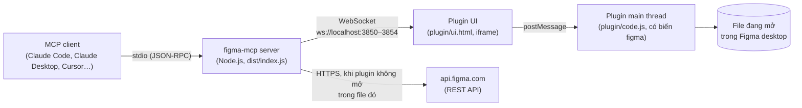
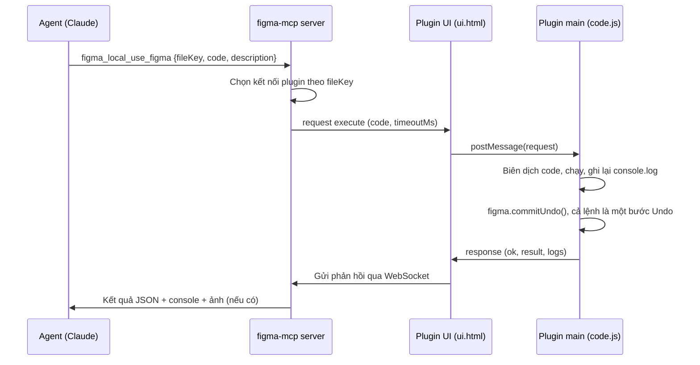
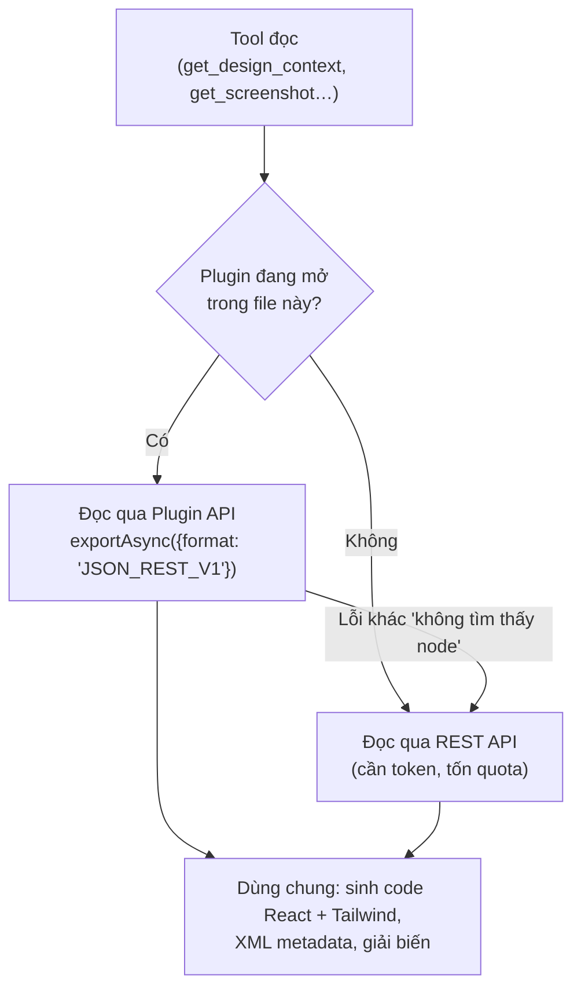

# Hướng dẫn Figma MCP Local Bridge

Tài liệu này hướng dẫn cài đặt từng bước, giải thích cách hệ thống hoạt động, liệt kê các tính năng và các giới hạn cần biết. Bản tiếng Anh ngắn gọn hơn nằm ở [README.md](README.md).

## Mục lục

1. [Đây là gì và vì sao cần](#1-đây-là-gì-và-vì-sao-cần)
2. [Cách hoạt động](#2-cách-hoạt-động)
3. [Tính năng](#3-tính-năng)
4. [Yêu cầu](#4-yêu-cầu)
5. [Cài đặt từng bước](#5-cài-đặt-từng-bước)
6. [Sử dụng hằng ngày](#6-sử-dụng-hằng-ngày)
7. [Giới hạn](#7-giới-hạn)
8. [Xử lý sự cố](#8-xử-lý-sự-cố)
9. [Cập nhật phiên bản](#9-cập-nhật-phiên-bản)
10. [Biến môi trường](#10-biến-môi-trường)
11. [Phát triển và kiểm thử](#11-phát-triển-và-kiểm-thử)

---

## 1. Đây là gì và vì sao cần

**Figma MCP Local Bridge** là một MCP server chạy trên máy của bạn. Nó cho các AI agent (Claude Code, Claude Desktop, Cursor…) đọc và chỉnh sửa file Figma, với **cùng tên tool và tham số như Figma MCP chính thức**, chỉ thêm tiền tố `figma_local_`.

Vì sao không dùng thẳng Figma MCP chính thức:

- **Giới hạn lượt gọi.** Với gói Starter hoặc ghế View/Collab, Figma MCP chính thức cho rất ít lượt gọi và hết rất nhanh.
- **REST API bị chặn khi dùng quá.** REST API của Figma giới hạn theo token. Khi vượt giới hạn, Figma có thể chặn đọc file trong **nhiều ngày** (ví dụ `429 … Retry after 397698s`).
- **Local Bridge đọc và ghi qua plugin.** Khi plugin "Figma MCP Bridge" đang mở trong file, mọi thao tác đọc đi qua Plugin API ngay trong Figma desktop và **không tốn quota REST**. Thao tác ghi (`use_figma`) luôn đi qua plugin.

Hai server có thể chạy song song: tool chính thức không có tiền tố, tool của bridge có tiền tố `figma_local_`, nên không trùng tên.

---

## 2. Cách hoạt động

### 2.1. Các thành phần



| Thành phần | Vai trò |
| --- | --- |
| **MCP server** (`src/`, build ra `dist/index.js`) | Client khởi động nó dưới dạng tiến trình con và nói chuyện qua stdio. Server khai báo các tool, mở cổng WebSocket cho plugin, và gọi REST API khi cần. Token Figma chỉ nằm trong tiến trình này. |
| **Plugin UI** (`plugin/ui.html`) | Cửa sổ nhỏ 280×150 của plugin. Main thread của plugin không có quyền mạng, nên iframe này giữ kết nối WebSocket tới server và chuyển tiếp tin nhắn. Nó thử kết nối tới cả 5 cổng `3850–3854` mỗi 3 giây. |
| **Plugin main thread** (`plugin/code.js`) | Nhận đoạn code JavaScript, biên dịch thành `async function (figma, console)`, chạy nó với toàn quyền Plugin API, rồi trả kết quả về. |
| **REST API** (`api.figma.com`) | Đường dự phòng cho thao tác đọc khi plugin không mở trong file, và là nguồn duy nhất cho thông tin thư viện và dev resources. |

### 2.2. Luồng một lệnh ghi (`use_figma`)



Chi tiết đáng chú ý:

- Code được thử như **một biểu thức** trước (`figma.currentPage.name` tự trả về giá trị), nếu không được thì chạy như **thân hàm** có `return`.
- Kết quả được chuyển thành JSON: node trở thành `{id, name, type}`; byte từ `exportAsync()` được đổi sang base64, và server trả PNG/JPEG về như **ảnh xem được**, SVG như văn bản.
- Khi có nhiều file cùng mở plugin, server chọn đúng file theo `fileKey`. Nếu chỉ có một kết nối mà plugin không đọc được file key, server coi đó là file đích.

### 2.3. Luồng đọc: ưu tiên plugin, dự phòng REST



- `exportAsync({ format: 'JSON_REST_V1' })` trả về **đúng dạng JSON** của REST endpoint `/v1/files/:key/nodes`, nên phần sinh code, metadata và biến chạy giống nhau ở cả hai đường.
- Ảnh chụp, export, SVG và ảnh fill do plugin render được lưu vào `FIGMA_ASSET_DIR` (mặc định `%TEMP%\figma-mcp-assets\<fileKey>\`). Khi đó tool trả **đường dẫn file cục bộ**; còn đường REST trả **URL tạm thời** của Figma.
- Mỗi phản hồi có trường `source` (`plugin` hoặc `rest`) để bạn biết dữ liệu đến từ đâu.
- Nếu cả hai đường đều lỗi, thông báo lỗi nêu cả hai nguyên nhân.

### 2.4. Nhiều phiên làm việc cùng lúc (host và relay)

Mỗi phiên Claude Code khởi động **một tiến trình server riêng**. Plugin chỉ kết nối tới 5 cổng `3850–3854`, nên:

1. **Host:** 5 tiến trình đầu tiên mỗi tiến trình giữ một cổng. Plugin kết nối tới tất cả, nên mọi phiên đều dùng chung **một cửa sổ plugin**. Plugin hiện "Connected to N MCP servers".
2. **Relay:** Từ tiến trình thứ 6, khi cả 5 cổng đã bị giữ, tiến trình mới kết nối vào một host và **gửi lệnh nhờ qua host đó**. Khi host tắt, relay chiếm cổng vừa trống hoặc chuyển sang host khác.
3. **Waiting:** Nếu không có host nào trả lời (ví dụ các cổng bị giữ bởi bản build cũ không hỗ trợ relay), tiến trình chờ và thử lại ở nền.

`figma_local_whoami` cho biết chế độ hiện tại (`host`, `relay`, `waiting`), cổng đang dùng và danh sách file đang mở plugin.

### 2.5. Bảo mật

- Bridge chỉ lắng nghe trên loopback (`127.0.0.1` và `::1`), không mở ra mạng ngoài.
- Bridge từ chối kết nối WebSocket có origin web thật, nên một tab trình duyệt không thể giả làm plugin. Iframe của plugin Figma có origin `null`.
- Relay phải trình **secret** trong `~/.figma-mcp/bridge-secret` (tạo tự động lần đầu, chỉ tài khoản của bạn đọc được). Người dùng khác trên cùng máy không gửi code vào plugin của bạn được.
- Token chỉ nằm trong tiến trình server; plugin không bao giờ thấy token.
- **Lưu ý:** `use_figma` chạy **bất kỳ** code nào agent gửi, với toàn quyền chỉnh sửa file đang mở. Mỗi lệnh là một bước Undo, nhưng với file quan trọng hãy theo dõi agent đang làm gì hoặc làm việc trên bản sao.

---

## 3. Tính năng

### 3.1. Danh sách tool

Tên dưới đây đã bỏ tiền tố. Khi gọi, dùng `figma_local_<tên>`.

| Tool | Nguồn dữ liệu | Làm gì |
| --- | --- | --- |
| `get_design_context` | plugin → REST | Công cụ chính để chuyển design thành code. Trả code tham khảo **React + Tailwind** (mỗi phần tử có `data-node-id`, biến dạng `var(--token, fallback)`), danh sách asset, component đang dùng, style, code link và ảnh chụp. Node quá lớn (hơn 2.500 layer) thì trả metadata, trừ khi đặt `forceCode`. |
| `get_metadata` | plugin → REST | XML cấu trúc layer: loại, tên, vị trí, kích thước. Không truyền `nodeId` thì liệt kê các trang. Khi plugin đang chạy, vùng đang chọn được liệt kê đầu tiên. |
| `get_screenshot` | plugin → REST | Ảnh PNG, giới hạn theo `maxDimension`. Trả đường dẫn file (plugin) hoặc URL kèm lệnh curl (REST). Chỉ trả base64 khi đặt `enableBase64Response`. |
| `get_variable_defs` | plugin → REST | `{tên: giá trị}` của các biến và style mà node đang dùng. |
| `get_figjam` | plugin → REST | Nội dung FigJam dạng XML (sticky, shape, connector có from/to, section, text) kèm ảnh. |
| `download_assets` | plugin → REST | Tải export, ảnh fill gốc (định dạng được nhận diện từ byte thật) và SVG. Tuân theo export settings của node trừ khi bạn ghi đè. |
| `get_code_connect_map` | plugin → REST, dev resources qua REST | Ánh xạ instance tới link code gắn trên main component (Dev Mode dev resources). |
| `search_design_system` | plugin → REST | Tìm component, style, biến trong file (kể cả biến từ thư viện đã bật); tìm cả thư viện team khi đặt `FIGMA_TEAM_ID`. |
| `get_libraries` | REST (một phần qua plugin) | Thư viện file đang dùng, những gì file publish, và (khi có `FIGMA_TEAM_ID`) thư viện team có thể thêm, có phân trang. |
| `use_figma` | plugin | Chạy JavaScript với biến `figma` để tạo, sửa, kiểm tra bất cứ thứ gì: frame, component, variant, biến, style, text, auto layout, ảnh, cả màn hình. Dùng được cho file design và FigJam. |
| `whoami` | REST + plugin | Người dùng đã xác thực, kiểu xác thực, tiền tố tool, chế độ bridge, các file đang mở plugin (kèm trang và vùng chọn). |

### 3.2. Điểm tiện lợi

- **Dán thẳng URL.** `fileKey` nhận cả link `figma.com/design/...`; `nodeId` nhận cả `1:2` và `1-2`. Link branch tự chuyển thành branch key.
- **Không đụng hàng với server khác.** Chạy song song với Figma MCP chính thức hoặc server Figma khác. Muốn dùng tên gốc không tiền tố thì đặt `FIGMA_TOOL_PREFIX=` (rỗng).
- **Prompt và skill viết cho tool chính thức vẫn dùng được**, agent chỉ cần gọi bản có tiền tố.
- **Nhiều phiên dùng chung một cửa sổ plugin** (xem mục 2.4).
- **Không cần token để ghi.** `use_figma` và các thao tác đọc qua plugin chạy được mà không cần token. Token chỉ cần cho đường REST và `whoami`.
- **Có thể gọi tool từ script** mà không cần agent, xem [`examples/call-tool.mjs`](examples/call-tool.mjs).

### 3.3. So với Figma MCP chính thức

| | Figma MCP chính thức | Local Bridge |
| --- | --- | --- |
| Chạy ở đâu | Server của Figma | Máy của bạn |
| Giới hạn lượt gọi | Theo gói Figma, rất thấp với Starter/View/Collab | Đọc và ghi qua plugin không giới hạn; REST theo quota của token |
| Sinh code | Generator nội bộ của Figma | Generator React + Tailwind riêng, kết quả khác với Figma |
| Biến (variables) | Đầy đủ | Qua plugin; REST variables chỉ có ở gói Enterprise |
| Code Connect | Đọc mapping từ Code Connect CLI | Chỉ đọc Dev Mode **dev resources** |
| Tạo file mới, `generate_figma_design`, `upload_assets`, `generate_diagram`, Figma Make | Có | **Không có** (phần lớn làm được qua `use_figma`) |
| Cần mở Figma desktop | Không | Cần, để ghi và để đọc không tốn quota |

---

## 4. Yêu cầu

- **Node.js 20.6 trở lên** (dự án yêu cầu Node 20+; cờ `--env-file` dùng trong hướng dẫn này cần 20.6+). Kiểm tra bằng `node --version`.
- **Git** để clone repo.
- **Figma desktop app** (Windows hoặc macOS). Plugin dạng development chỉ chạy trong app desktop, không chạy trên trình duyệt.
- **Quyền chỉnh sửa** file Figma cần ghi.
- Một MCP client: Claude Code, Claude Desktop, Cursor, hoặc client khác hỗ trợ MCP qua stdio.
- (Khuyến nghị) **Personal access token** của Figma cho đường REST.

---

## 5. Cài đặt từng bước

Ví dụ dưới đây dùng thư mục `D:/FigmaMCP-LocalBridge`. Đổi thành thư mục của bạn. Trên Windows, trong file cấu hình nên viết đường dẫn bằng dấu `/` (hoặc `\\` trong JSON).

### Bước 1. Clone và build

```bash
git clone https://github.com/deniahc566/FigmaMCP-LocalBridge.git D:/FigmaMCP-LocalBridge
```

```bash
cd D:/FigmaMCP-LocalBridge
```

```bash
npm install
```

```bash
npm run build
```

Sau bước này phải có file `dist/index.js`. Thư mục `dist/` và `node_modules/` không nằm trong repo; mỗi máy tự build.

### Bước 2. Tạo personal access token

1. Trong Figma, mở **Settings → Security → Personal access tokens → Generate new token**.
2. Chọn các scope:

| Scope | Dùng cho |
| --- | --- |
| `file_content:read` | Mọi thao tác đọc file qua REST |
| `current_user:read` | `whoami` |
| `file_dev_resources:read` | `get_code_connect_map`, code link trong `get_design_context` |
| `library_content:read` | Component và style đã publish của file |
| `library_assets:read` | Giải component từ thư viện (`get_libraries`, code link) |
| `team_library_content:read`, `projects:read` | Tìm thư viện team (chỉ khi có `FIGMA_TEAM_ID`) |
| `file_variables:read` | REST variables (chỉ Enterprise, không bắt buộc) |

3. Sao chép token (bắt đầu bằng `figd_`). Figma chỉ hiện token một lần.

### Bước 3. Tạo file `.env`

Sao chép [`.env.example`](.env.example) thành `.env` trong thư mục gốc của repo rồi điền token:

```bash
cp .env.example .env
```

```dotenv
FIGMA_ACCESS_TOKEN=figd_xxxxxxxxxxxxxxxx
```

`.env` đã nằm trong `.gitignore`, **không bao giờ commit file này**. Cách này giữ token ngoài file cấu hình của client.

### Bước 4. Đăng ký server với MCP client

**Claude Code** (đăng ký cho mọi dự án với `--scope user`):

```bash
claude mcp add --scope user figma-local -- node --env-file=D:/FigmaMCP-LocalBridge/.env D:/FigmaMCP-LocalBridge/dist/index.js
```

Kiểm tra:

```bash
claude mcp list
```

Dòng `figma-local` phải hiện `✓ Connected`. Nếu không dùng file `.env`, có thể truyền token trực tiếp: `claude mcp add --scope user figma-local -e FIGMA_ACCESS_TOKEN=figd_... -- node D:/FigmaMCP-LocalBridge/dist/index.js`.

**Claude Desktop, Cursor và client cấu hình bằng JSON.** File cấu hình:

- Claude Desktop trên Windows: `%APPDATA%\Claude\claude_desktop_config.json`
- Claude Desktop trên macOS: `~/Library/Application Support/Claude/claude_desktop_config.json`
- Cursor: `~/.cursor/mcp.json` (toàn máy) hoặc `.cursor/mcp.json` (một dự án)

```json
{
  "mcpServers": {
    "figma-local": {
      "command": "node",
      "args": [
        "--env-file=D:/FigmaMCP-LocalBridge/.env",
        "D:/FigmaMCP-LocalBridge/dist/index.js"
      ]
    }
  }
}
```

Khởi động lại client sau khi sửa cấu hình.

### Bước 5. Cài plugin vào Figma desktop (làm một lần)

1. Mở **Figma desktop** và mở một file bất kỳ.
2. Vào menu **Plugins → Development → Import plugin from manifest…** (hoặc chuột phải trên canvas → **Plugins → Development → Import plugin from manifest…**).
3. Chọn file `D:/FigmaMCP-LocalBridge/plugin/manifest.json`.

Plugin "Figma MCP Bridge" giờ xuất hiện trong **Plugins → Development**. Figma đọc `code.js` và `ui.html` từ ổ đĩa mỗi lần chạy, nên khi cập nhật repo không cần import lại (trừ khi `manifest.json` thay đổi).

### Bước 6. Chạy plugin trong file cần làm việc

1. Mở file Figma cần đọc hoặc sửa.
2. Chạy **Plugins → Development → Figma MCP Bridge**.
3. Xem trạng thái trên cửa sổ plugin:
   - **"Connected to 1 MCP server"** (hoặc N servers) kèm **"File: <tên file>"**: đã kết nối.
   - **"Looking for the MCP server…"** hoặc **"Scanning localhost:3850–3854"**: chưa có server nào chạy. Mở một phiên Claude Code (hoặc client của bạn) để client khởi động server; plugin tự thử lại mỗi 3 giây.
4. **Giữ cửa sổ plugin mở** suốt lúc làm việc. Đóng plugin là mất kết nối.

### Bước 7. Kiểm tra toàn bộ

Trong phiên Claude Code, yêu cầu:

> Gọi `figma_local_whoami`.

Kết quả đúng có dạng:

```json
{
  "auth": { "method": "personal-access-token" },
  "toolPrefix": "figma_local_",
  "bridge": {
    "mode": "host",
    "listening": true,
    "port": 3850,
    "plugins": [{ "fileName": "Tên file của bạn", "pageName": "Page 1" }]
  }
}
```

Rồi thử ghi:

> Dùng `figma_local_use_figma` chạy `return figma.currentPage.name` trong file đang mở.

Nếu nhận lại tên trang, mọi thứ đã sẵn sàng.

---

## 6. Sử dụng hằng ngày

### 6.1. Quy trình

1. Mở Figma desktop, mở file cần làm.
2. Chạy plugin **Figma MCP Bridge** trong file đó.
3. **Để file ở tab đang hiển thị**, không thu nhỏ cửa sổ Figma (cần thiết cho ảnh chụp và export, xem mục 7).
4. Giao việc cho agent, nhắc tên tool hoặc dán link Figma.

### 6.2. Ví dụ yêu cầu cho agent

- "Dùng figma_local_get_design_context cho link `https://www.figma.com/design/<FILE_KEY>/Ten-file?node-id=12-34` rồi dựng lại bằng React + Tailwind trong dự án này."
- "Dùng figma_local_get_screenshot chụp frame đang chọn và so với màn hình trong code."
- "Dùng figma_local_search_design_system tìm component Button và các biến màu primary."
- "Dùng figma_local_use_figma tạo màn hình đăng nhập 375×812 trên trang hiện tại, dùng component có sẵn trong file."

### 6.3. Viết code cho `use_figma`

Code chạy như thân một `async function` có sẵn `figma` và `console`:

```js
await figma.loadFontAsync({ family: 'Inter', style: 'Regular' });

const frame = figma.createFrame();
frame.name = 'Login';
frame.resize(375, 812);
frame.layoutMode = 'VERTICAL';
frame.paddingTop = frame.paddingBottom = frame.paddingLeft = frame.paddingRight = 24;
frame.itemSpacing = 16;

const title = figma.createText();
title.characters = 'Đăng nhập';
title.fontSize = 24;
frame.appendChild(title);

figma.currentPage.appendChild(frame);
console.log('Đã tạo', frame.id);
return { id: frame.id };
```

Nguyên tắc nên theo:

- **Luôn `return` ID của những gì đã tạo**, để các lệnh sau tìm lại được.
- **Viết code idempotent:** kiểm tra node đã tồn tại (theo tên) trước khi tạo, vì một lệnh bị timeout vẫn có thể chạy xong trong plugin (xem mục 7).
- **Dùng API async:** `await figma.getNodeByIdAsync(id)`, `await figma.setCurrentPageAsync(page)`, `await page.loadAsync()`, `setTextStyleIdAsync`, `getMainComponentAsync`. API đồng bộ tương ứng sẽ báo lỗi do file dùng dynamic page loading.
- **Nạp font trước khi đặt text:** `await figma.loadFontAsync({ family, style })`. Lưu ý style của Inter là `"Semi Bold"` (có dấu cách), không phải `"SemiBold"`.
- **Trả về dữ liệu gọn:** kết quả trên 100.000 ký tự bị cắt.
- **Chia nhỏ việc lớn:** mỗi lệnh tối đa 50.000 ký tự code. Dựng nhiều màn hình thì chia thành nhiều lệnh.

### 6.4. Mẹo nâng cao: lưu thư viện hàm trong `clientStorage`

Khi nhiều lệnh dùng chung các hàm tiện ích (tạo nút, áp token màu…), lưu mã nguồn một lần rồi nạp lại ở mỗi lệnh, để khỏi gửi lại cùng một đoạn code lớn:

```js
// Lệnh 1: lưu thư viện
await figma.clientStorage.setAsync('my_lib', `
  return {
    solid: (hex) => ({ type: 'SOLID', color: {
      r: parseInt(hex.slice(1, 3), 16) / 255,
      g: parseInt(hex.slice(3, 5), 16) / 255,
      b: parseInt(hex.slice(5, 7), 16) / 255 } }),
  };
`);
```

```js
// Các lệnh sau: nạp và dùng
const AsyncFunction = Object.getPrototypeOf(async function () {}).constructor;
const lib = await new AsyncFunction('figma', await figma.clientStorage.getAsync('my_lib'))(figma);
const rect = figma.createRectangle();
rect.fills = [lib.solid('#EE0033')];
return rect.id;
```

`clientStorage` lưu trên máy của bạn, theo plugin, không nằm trong file Figma.

### 6.5. Gọi tool từ script, không cần agent

[`examples/call-tool.mjs`](examples/call-tool.mjs) khởi động server với `.env` của repo và gọi một tool. Chạy từ thư mục gốc của repo sau khi đã build:

```bash
node examples/call-tool.mjs whoami
```

```bash
node examples/call-tool.mjs use_figma '{"fileKey":"<FILE_KEY>","code":"return figma.currentPage.name","description":"Đọc tên trang"}'
```

Trong PowerShell, đặt JSON trong dấu nháy đơn như trên; trong `cmd.exe` phải thoát dấu nháy kép. Cách này hợp để chạy hàng loạt kịch bản dựng design system mà không tốn lượt của agent.

---

## 7. Giới hạn

### 7.1. Giới hạn từ Figma và Plugin API

| Giới hạn | Ảnh hưởng | Cách xử lý |
| --- | --- | --- |
| Chỉ chạy trong **Figma desktop**, plugin phải **đang mở trong đúng file** | Đóng plugin, đóng file hoặc tắt Figma là mất kết nối ghi | Mở lại plugin; server tự nhận lại kết nối |
| Figma **tạm dừng render** khi file ở tab nền hoặc cửa sổ bị thu nhỏ | `get_screenshot`, export, SVG chờ tới 25 giây rồi chuyển sang REST; một số lệnh async (`loadFontAsync`, `setTextStyleIdAsync`) có thể treo | Đưa file lên phía trước trước khi chụp ảnh hoặc kiểm tra trực quan. Đọc dữ liệu (không render) vẫn chạy bình thường |
| **Main thread của plugin không có mạng** | Code trong `use_figma` không `fetch` được, kể cả tới localhost | Gửi nội dung trực tiếp trong `code`. Ảnh đã có trong file thì dùng lại qua `imageHash` |
| Chỉ có **Plugin API công khai** | Không có các hàm tiện ích riêng của server chính thức | Viết bằng Plugin API chuẩn |
| File dùng **dynamic page loading** | API đồng bộ (`getNodeById`, `mainComponent`, `textStyleId = …`) báo lỗi | Dùng bản async (mục 6.3) |
| Không thêm node vào bên trong layer con của **instance** | Lệnh `appendChild` vào sublayer instance báo lỗi | `detachInstance()` trước, hoặc sửa main component |
| Ghi cần quyền **chỉnh sửa** file | Với file chỉ có quyền xem, `use_figma` không sửa được gì | Xin quyền edit hoặc nhân bản file về drafts |

### 7.2. Giới hạn của server và bridge

| Giới hạn | Giá trị |
| --- | --- |
| Độ dài `code` mỗi lệnh `use_figma` | Tối đa **50.000 ký tự** |
| Kết quả trả về | Cắt sau **100.000 ký tự**; tối đa **5 ảnh** mỗi lệnh; JSON lồng tối đa 12 cấp, mảng tối đa 5.000 phần tử |
| Timeout `use_figma` | Mặc định **60 giây**, tối đa **300 giây** (`timeoutMs`) |
| Timeout đọc qua plugin | 90 giây cho dữ liệu, **25 giây** cho render (ảnh, export) |
| `get_design_context` | Trên **2.500 layer** thì trả metadata thay cho code (trừ khi `forceCode: true`); hãy gọi trên node con |
| Số tiến trình giữ cổng trực tiếp | **5** (cổng `3850–3854`); tiến trình thứ 6 trở đi dùng relay |

Hai điểm dễ gây nhầm:

- **Lệnh timeout chưa chắc đã dừng.** Server ngừng chờ sau thời gian timeout, nhưng code trong plugin vẫn chạy tiếp và có thể hoàn tất sau đó. Trước khi chạy lại, hãy kiểm tra trạng thái file để không tạo trùng.
- **Duyệt trang rất lớn dễ timeout.** `findAll` trên trang 50.000+ node hoặc khảo sát cả file trong một lệnh thường quá giờ. Duyệt thủ công từng trang (hoặc vài trang mỗi lệnh), trả về chuỗi gọn, và lưu kết quả trung gian vào `clientStorage`.

### 7.3. Giới hạn của REST API và tính năng

- **Rate limit thấp** với gói Free/Starter và ghế View/Collab. Khi gặp 429, server thử lại tối đa 3 lần nhưng chỉ chờ tối đa 20 giây; quá mức đó thì báo lỗi ngay kèm thời gian Figma yêu cầu chờ. Cách tránh: mở plugin trong file để đọc qua plugin.
- **REST variables chỉ có ở gói Enterprise.** Ở gói khác, tên biến lấy từ plugin; không có cả hai thì biến hiện dưới dạng ID chưa giải được, kèm giá trị thô.
- **Code Connect:** mapping publish bằng Code Connect CLI không đọc được qua API công khai. Server đọc **dev resources** trong Dev Mode, nên hãy gắn link code tại đó.
- **Thư viện:** API không cho biết thư viện nào đang bật cho file; `get_libraries` báo các thư viện file thực sự dùng. Thông tin thư viện và dev resources chỉ lấy được qua REST.
- **URL ảnh từ REST là tạm thời** và hết hạn sau một thời gian; ảnh từ plugin là file cục bộ.
- **Sinh code là generator riêng:** hỗ trợ auto layout (flex, wrap, grid), sizing FIXED/HUG/FILL, con tuyệt đối với constraints, fill, gradient, ảnh, viền, bo góc, bóng, blur, blend mode, text style có ghi đè theo đoạn, icon xuất SVG. Kết quả sẽ khác output của Figma; xem như code tham khảo để chỉnh theo dự án.
- **Không có:** `create_session`, `create_new_file`, `generate_figma_design`/`html_to_figma`, `upload_assets`, `add_code_connect_map`, `generate_diagram`, file Figma Make, và skill resource của server chính thức.

---

## 8. Xử lý sự cố

| Triệu chứng | Nguyên nhân | Cách xử lý |
| --- | --- | --- |
| Plugin hiện "Looking for the MCP server…" / "Scanning localhost:3850–3854" | Chưa có tiến trình server nào chạy | Mở phiên Claude Code hoặc client đã cấu hình; chạy `claude mcp list` để kiểm tra |
| `claude mcp list` báo `figma-local` lỗi kết nối | Sai đường dẫn, chưa build, thiếu `.env`, hoặc Node quá cũ | Kiểm tra `dist/index.js` tồn tại, file `.env` đúng đường dẫn, `node --version` ≥ 20.6. Thử chạy tay: `node --env-file=.env dist/index.js` (sẽ in `plugin bridge listening on …`; nhấn Ctrl+C để thoát) |
| `No Figma plugin is connected…` | Plugin chưa chạy | Chạy **Plugins → Development → Figma MCP Bridge** trong file |
| `No connected plugin is running in file <key>…` | Plugin đang mở ở file khác | Chạy plugin trong đúng file, hoặc kiểm tra lại `fileKey` |
| `Several Figma files have the plugin open; pass fileKey…` | Nhiều file cùng mở plugin | Truyền `fileKey` (hoặc dán link file) |
| `The plugin did not finish rendering within 25s…` | File ở tab nền hoặc Figma bị thu nhỏ | Đưa file lên phía trước rồi thử lại |
| `The plugin did not reply within Ns` / `Code timed out after Ns` | Code chạy quá lâu | Tăng `timeoutMs` (tối đa 300.000), chia nhỏ việc; **kiểm tra trạng thái file trước khi chạy lại** |
| `Figma API 429 … Retry after …` | Hết quota REST của token | Mở plugin trong file để đọc qua plugin; hoặc chờ hết thời gian chặn |
| `No Figma token configured…` | Thiếu token, mà thao tác cần REST | Thêm `FIGMA_ACCESS_TOKEN` vào `.env`, khởi động lại phiên |
| `Cannot write to node with unloaded font …` | Chưa nạp font | `await figma.loadFontAsync({ family, style })` trước khi sửa text |
| Lỗi API đồng bộ kiểu `… use getNodeByIdAsync …` | File dùng dynamic page loading | Dùng các API `…Async` |
| `whoami` hiện `plugins: []` nhưng plugin báo đã kết nối | Tiến trình đang ở chế độ relay hoặc danh sách chưa kịp đồng bộ | Thử gọi `use_figma` trước; nếu vẫn lỗi, chạy lại plugin |
| Lỗi giữa chừng kiểu "instance shut down" | Host mà relay đi qua vừa tắt | Plugin và relay tự kết nối lại trong vài giây; kiểm tra trạng thái rồi mới chạy lại |
| `… does not hold a usable secret…` | File secret hỏng | Xóa `~/.figma-mcp/bridge-secret` (Windows: `%USERPROFILE%\.figma-mcp\bridge-secret`), mở lại phiên |
| Phiên mới luôn ở chế độ `waiting` | 5 cổng bị giữ bởi phiên chạy bản build cũ | Khởi động lại các phiên cũ để chúng dùng bản mới |
| Muốn đổi cổng | Cổng `3850–3854` bị phần mềm khác chiếm | Đặt `FIGMA_BRIDGE_PORTS`, đồng thời sửa `devAllowedDomains` trong `plugin/manifest.json` và `PORTS` trong `plugin/ui.html`, rồi import lại plugin |

Log chẩn đoán của server được ghi ra **stderr** với tiền tố `[figma-mcp]` (stdout dành cho giao thức MCP). Để xem log, chạy tay server bằng lệnh ở dòng thứ hai của bảng trên, hoặc dùng `node examples/call-tool.mjs whoami` (script in cả log của server).

---

## 9. Cập nhật phiên bản

```bash
git pull
```

```bash
npm install
```

```bash
npm run build
```

Sau đó **khởi động lại các phiên** Claude Code/Cursor đang mở để chúng chạy bản mới. Plugin không cần import lại trừ khi `plugin/manifest.json` thay đổi; chỉ cần đóng và chạy lại plugin trong Figma.

---

## 10. Biến môi trường

| Biến | Mặc định | Ý nghĩa |
| --- | --- | --- |
| `FIGMA_ACCESS_TOKEN` | — | Personal access token (gửi qua header `X-Figma-Token`). `FIGMA_API_KEY` cũng được. |
| `FIGMA_OAUTH_TOKEN` | — | OAuth token (gửi dạng `Bearer`). Được ưu tiên khi đặt cả hai. |
| `FIGMA_TEAM_ID` | — | Bật tìm thư viện team và danh sách "có thể thêm". ID nằm trong URL trang team: `figma.com/files/team/<id>/…` |
| `FIGMA_ASSET_DIR` | `<thư mục tạm>/figma-mcp-assets` | Nơi lưu ảnh và asset do plugin render, mỗi file một thư mục con. |
| `FIGMA_TOOL_PREFIX` | `figma_local_` | Tiền tố tên tool. Đặt rỗng để dùng tên gốc, hoặc tiền tố riêng (chữ, số, `_`, `-`). |
| `FIGMA_BRIDGE` | `on` | Đặt `off` để tắt bridge (chỉ còn đọc qua REST, không có `use_figma`). |
| `FIGMA_BRIDGE_HOST` | `127.0.0.1` | Địa chỉ bridge lắng nghe. |
| `FIGMA_BRIDGE_PORTS` | `3850-3854` | Các cổng thử lần lượt. Đổi thì phải sửa cả plugin (mục 8). |
| `FIGMA_BRIDGE_SECRET_FILE` | `~/.figma-mcp/bridge-secret` | Secret cho relay. Mọi tiến trình phải dùng cùng một file. |
| `FIGMA_BRIDGE_TIMEOUT_MS` | `60000` | Timeout mặc định của `use_figma`. |
| `FIGMA_API_BASE` | `https://api.figma.com` | Địa chỉ REST (bộ test trỏ vào server giả). |

---

## 11. Phát triển và kiểm thử

```bash
npm test
```

Lệnh này build rồi chạy:

- `test/codegen.test.mjs`: phân tích URL, sinh code layout/text/asset/biến, và XML metadata trên một design mẫu.
- `test/e2e.test.mjs`: khởi động server thật qua stdio với REST API giả, chạy `plugin/code.js` thật trên biến `figma` giả, chuyển tiếp qua WebSocket giống `ui.html`. Kiểm tra đọc qua plugin không gọi REST, dự phòng sang REST khi plugin không đọc được, và cơ chế relay (gọi qua relay, từ chối peer sai secret, relay chiếm cổng khi host tắt).
- `test/naming.test.mjs`: tiền tố tên tool (mặc định, rỗng, tùy chỉnh, không hợp lệ).

Dùng `npm run dev` để build lại tự động khi sửa `src/`.

Cấu trúc thư mục:

```
src/
  index.ts            điểm vào stdio, khởi động bridge
  server.ts           McpServer và hướng dẫn cho agent
  config.ts           đọc biến môi trường
  figma/reader.ts     đọc ưu tiên plugin (JSON_REST_V1, render), dự phòng REST
  figma/rest.ts       REST client (thử lại khi 429/5xx, cache ngắn hạn)
  figma/variables.ts  giải biến: plugin → REST (Enterprise) → chưa giải
  bridge/server.ts    WebSocket bridge tới plugin, relay giữa các tiến trình
  codegen/            sinh React + Tailwind, XML metadata, xử lý paint
  tools/              định nghĩa tool, nhóm theo chức năng
plugin/               plugin Figma đi kèm (manifest, main thread, UI relay)
examples/             script gọi tool không cần agent
test/                 bộ kiểm thử
```
